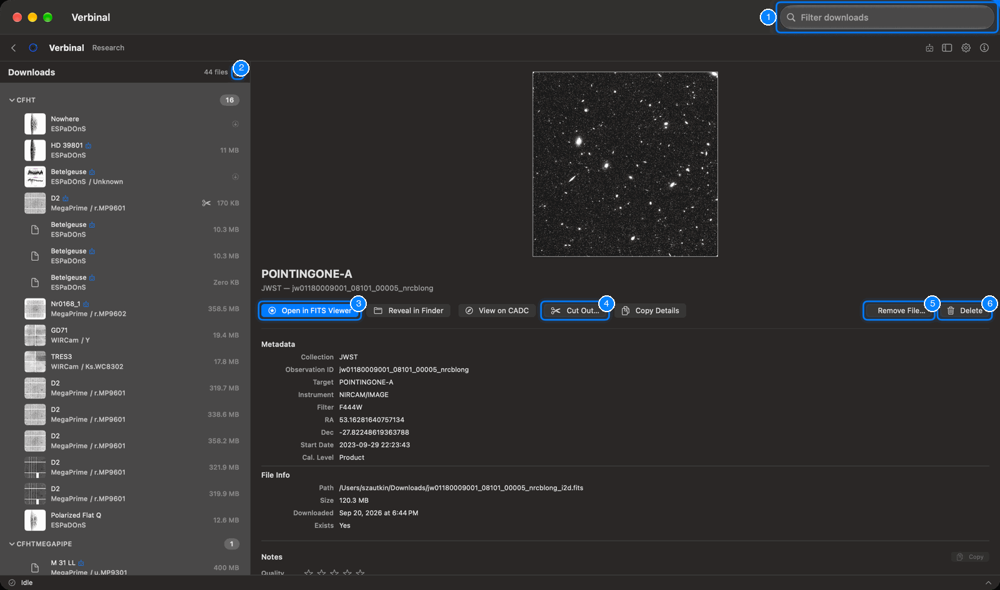
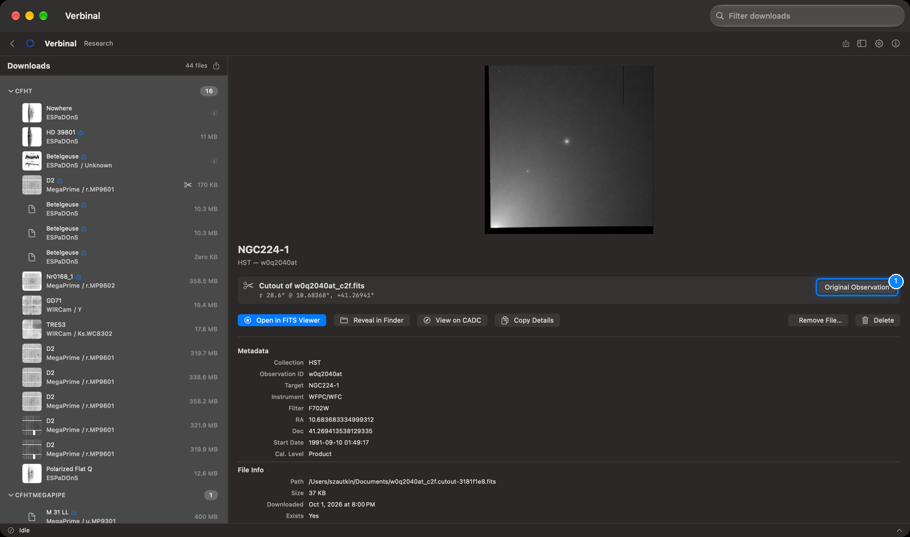
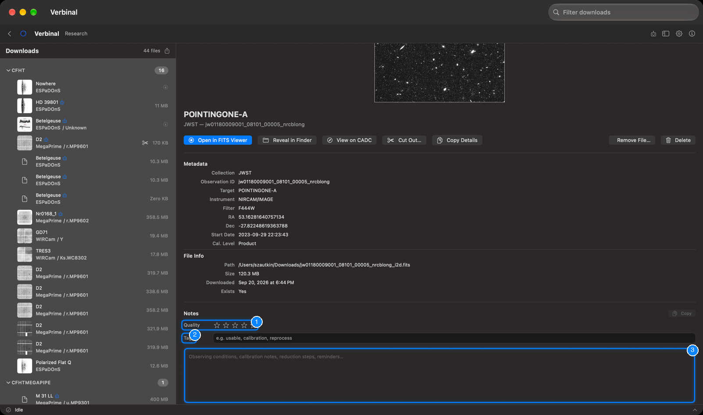
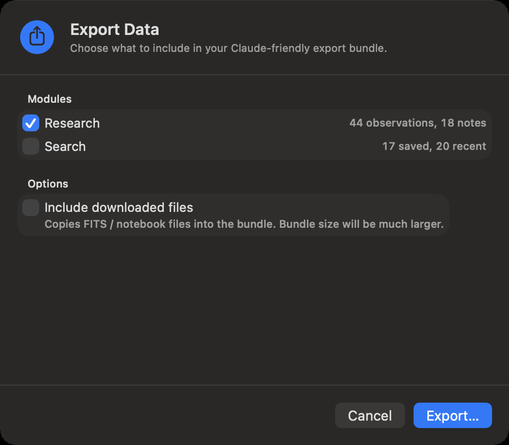

# Research: your observations

Research is where the observations you keep live, on this Mac: those you downloaded, those you saved
without their file, and your cutouts, each with your notes, tags and rating. It works without signing
in. Open it from its Home tile, or **Go ▸ Research** (⌘2).

1. **Filter downloads**: finds an observation by its target, collection, instrument or observation
   ID, and by the words of your notes and tags.
2. The export button beside the count: [Exporting everything](#exporting-everything).
3. **Open in FITS Viewer**: the observation's file, in the viewer that fits it.
4. **Cut Out…**: a part of the observation, as in Search.
5. **Remove File…**: deletes the file and keeps the observation.
6. **Delete**: removes the observation from Research.

## Getting observations into Research

From [Search](02-search.md), in an observation's detail or a result's right-click menu:

- **Download** fetches the file into your download folder, and keeps the observation here with it.
- The download button of a file in the detail's **Files** tab keeps that file with the observation,
  beside its main file.

Downloads go to your download folder, never over another file: **Downloads** unless you choose another
in **Settings ▸ General ▸ Downloads**, or with **Change…** where you download. Research keeps where each
file went.
- **Save to Research** keeps the observation without its file, for notes now and a download later.
- **Download Cutout** keeps the cutout here, linked to its original observation.

## The list

The list on the left groups your observations by collection, with how many each holds. Each row
shows the preview, the target, the instrument and filter, and the file's size. Scissors mark a cutout;
an arrow marks an observation kept without its file. A laptop and a cloud say where its file is: the
laptop lit when it is on this Mac, the cloud when it is in your storage
([This Mac and your storage](#this-mac-and-your-storage)). The count at the top says how many there are.

Right-click a row for **Open File**, **Reveal in Finder**, **Download**, **Send a Copy to Storage** or
**Get a Copy from Storage**, **Copy Details** and **Delete**.

Your observations also show in the Mac's Spotlight: search for a target, a collection or an instrument
there, and choosing a result opens Verbinal.

## An observation

Select a row to see the observation: its preview, target, collection and observation ID, then:

- **Metadata**: **Collection**, **Observation ID**, **Target**, **Instrument**, **Filter**, **RA**,
  **Dec**, **Start Date**, **Cal. Level**.
- **File Info**: the file's **Path**, **Size**, when it was **Downloaded**, and whether it **Exists**.
  For an observation kept without its file, **File** says **Not downloaded**.
- **Files**: the observation's files: its main file, then those downloaded one by one from the
  **Files** tab or by an assistant. Each shows where it is on this Mac and in your storage, its size,
  the laptop and cloud of where it is, and buttons to open it, show it in the Finder, and remove it.
  The trash asks first; the observation and its notes stay.

Its buttons:

| Button | What it does |
|---|---|
| **Open in FITS Viewer** | Opens the file in the [FITS Viewer](04-fits-viewer.md). For a cube it reads **Open in Cube Viewer**; for a file that is not FITS, **Open File** opens it in its usual app. |
| **Reveal in Finder** | Shows the file in the Finder. |
| **View on CADC** | The observation's page on CADC's website. |
| **Cut Out…** | The [cutout editor](02-search.md#cutouts). |
| **Copy Details** | Copies the observation's ID, position, instrument and date as text. |
| **Download** | For an observation kept without its file: fetches it into this same record, with its notes. |
| **Get from Storage** | For an observation whose file is only in your storage: copies it back to this Mac. It stays in your storage too. |
| **Download Again** | When the file is missing, cannot be opened, or is empty: fetches it again. |
| **Remove File…** | Deletes the file from this Mac; the observation, its details and notes stay, and **Download** fetches it again. When the file is in your storage too, that copy stays. |
| **Delete** | Removes the observation from Research, and its files from your disk. This cannot be undone. Your notes are kept: if you keep the observation again, they come back. |

### Cutouts

A cutout's record says what it is (**Cutout of** …) and the region it covers. **Original Observation**
shows the complete observation it was cut from, when that one is in Research too.

## This Mac and your storage

An observation's file can be on this Mac, in your CANFAR storage, or both. Where it is shows beside it,
in the list and in **Files**: a laptop for this Mac and a cloud for your storage, each lit where the file
is. Hold the pointer over them to read it: **On this Mac only**, **In your storage only**, **On this Mac
and in your storage**.

Click them for what you can do with that file. You need to be signed in to CANFAR.

| Choice | What it does |
|---|---|
| **Send a Copy to Storage** | Copies the file to `Verbinal-Results/research/` in your storage. It stays on this Mac. |
| **Move to Storage…** | Copies it to your storage, then deletes it from this Mac once it is there. |
| **Get a Copy from Storage** | Copies the file back to your download folder. It stays in your storage. |
| **Move to This Mac…** | Copies it to this Mac, then deletes it from your storage once it is here. |
| **Remove from This Mac…** | Deletes the copy on this Mac; the one in your storage stays. Verbinal first looks that it is still there: when it is gone, or your storage cannot be reached, the copy on this Mac stays. |
| **Remove from Storage…** | Deletes the copy in your storage; the one on this Mac stays. |

A move always copies first, and deletes the other copy only when the new one is in place, so a failure
halfway leaves the file where it was. Verbinal never removes the last copy of a file: a file only on this
Mac can be removed from it with **Remove File…**, which asks first. A file of the same name already in
your storage is never written over. Moves, removals and deletions each ask you first.

Removing an observation's file from this Mac frees space and keeps its details, notes and where it is in
your storage; opening it again needs **Get from Storage** first.

## Notes, tags and rating

Below the details, each observation has your notes:

1. **Quality**: one to five stars, from **Unusable** to **Excellent**; **Clear** removes the rating.
2. **Tags**: words separated by commas, such as `usable, calibration, reprocess`.
3. **Notes**: anything you want to remember: observing conditions, calibration notes, reduction
   steps. It says when you last edited it and how many words it holds, and **Copy** copies it.

Notes are saved as you type. The filter at the top searches them too.

## Research on every device

Turn on **Research** under **Your Work in VOSpace** in **Settings ▸ Storage**, and your observations' details, notes,
tags and quality are kept in your CANFAR storage too: the same Research on every Mac you sign in on, and
in Verbinal for Windows and Linux as they follow. Files are not: each device downloads its own. A note
you write here reaches the others a few seconds after you stop typing; theirs reach you when you sign in,
and when you come back to Verbinal. Removing an observation here removes it there too; its notes stay.
A note changed on two Macs before they synced keeps both changes when they are to different parts — its
text on one, its tags on the other. When both changed the same part, the one in your storage stays and
yours waits for you in **Settings ▸ Storage ▸ Conflicts**; an observation removed on one Mac but changed
on another is kept, with its change, and you are asked there too.
See [Settings ▸ Storage](14-settings.md#storage).

### Where Research keeps its records on this Mac

The menu beside the count at the top of the list says where Research keeps its records on this Mac: in
a file, as it always has, or in Verbinal's database. Only you move them, with **Move into the
Database…** or **Move Back to a File…**; no update and no assistant does.

Moving into the database first copies Research's file to a dated backup beside it, then writes every
record and checks each one. If any record does not come back as it went, nothing moves and Research
stays in its file. Your files and notes are not touched. **Move Back to a File…** writes the records into
the file again, reads them back and checks them before it switches.

## Exporting everything

**File ▸ Export All…** (⇧⌘E), or the export button in Research, opens **Export Data**: a bundle of your
work that you can archive, share, or give to an AI assistant.

1. Under **Modules**, tick what to include: **Research** (your observations and notes) and **Search**
   (your saved and recent searches).
2. Under **Options**, **Include downloaded files** copies the FITS and notebook files into the bundle
   too; it makes it much larger.
3. Click **Export…**, choose a folder, and click **Export Here**. Verbinal makes a folder named with the
   date and time inside it.

The bundle starts with a `README.md` and a `manifest.json` that describe what is in it. When it is
done, **Export complete** offers **Reveal in Finder**, **Copy Path**, **Share…**, and, when you are
signed in, **Upload to VOSpace**, which puts a zipped copy in the `Verbinal-Exports` folder of your
storage. A notification tells you when an export finishes.

## What an assistant can do here

It can list and read your observations and notes, finding them as the filter does (a word of a note, or
a tag), write notes, tags and ratings (up to 50 at once),
open files in the viewers, download what you kept without a file or one file of an observation, cut
out, and export. It can see where each file is, send a copy to your storage and get one back. Removing a
file, from this Mac or from your storage, or an observation waits for you unless you allowed that kind of
change. It never removes a file's last copy, and it cannot move Research's records between their file and
the database: that is yours.
